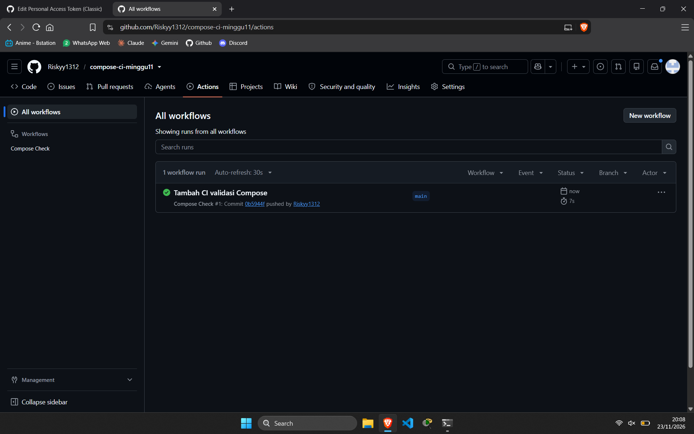
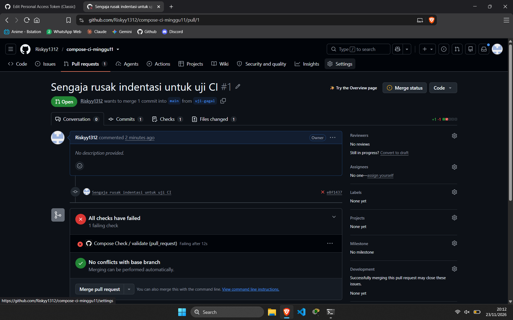
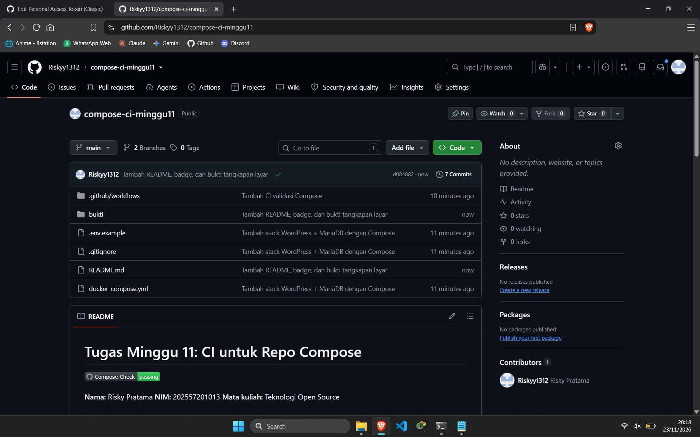

# Tugas Minggu 11: CI untuk Repo Compose

**Nama:** Risky Pratama
**NIM:** 202557201013
**Mata kuliah:** Teknologi Open Source

## Deskripsi
Workflow ini memeriksa sintaks file docker-compose.yml secara otomatis. Ia berjalan setiap ada push ke branch main dan setiap ada Pull Request.

## Isi repositori
- .github/workflows/compose-check.yml : workflow CI
- docker-compose.yml : stack WordPress + MariaDB (tugas minggu 10)
- .env.example : contoh variabel lingkungan tanpa rahasia asli
- .gitignore : mengabaikan .env
- bukti/ : tiga tangkapan layar bukti

## Cara kerja workflow
Pemicunya push ke main dan pull_request. Ada satu job bernama validate yang berjalan di runner ubuntu-latest. Ada tiga step: checkout mengambil kode repo ke runner, lalu .env.example disalin menjadi .env karena .env asli tidak ada di repo, lalu docker compose config -q memeriksa sintaks tanpa menjalankan container.

## Bukti
1. Run hijau di tab Actions

2. Pull Request dengan check gagal (merah)

3. Badge status di README

Tautan Pull Request (sudah hijau dan di-merge): https://github.com/Riskyy1312/compose-ci-minggu11/pull/1

## Kendala dan cara mengatasinya
Saat sengaja merusak indentasi, check di PR menjadi merah dengan pesan: "yaml: line 4, column 12: mapping values are not allowed in this context". Baris image: kehilangan satu spasi, sehingga baris restart: di bawahnya dibaca sebagai lanjutan nilai image dan YAML menolak tanda titik dua kedua. Saya memperbaikinya dengan mengembalikan indentasi menjadi 4 spasi di branch yang sama, lalu check berubah hijau.

## Refleksi singkat
Dengan CI, kesalahan di file Compose ketahuan beberapa menit setelah push, sebelum digabung ke main. Saya tidak perlu mengingat untuk mengujinya sendiri, dan hasilnya terlihat jelas lewat badge.# compose-ci-minggu11
